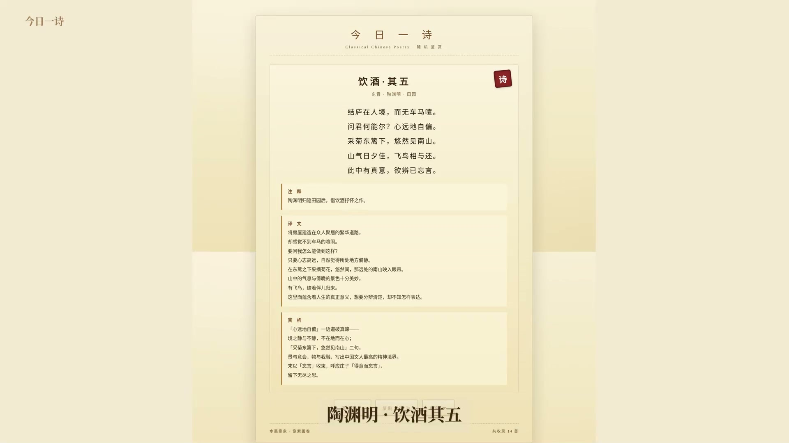

# 古典诗词鉴赏 · 今日一诗

> 水墨意象 · 像素画卷

一个**零依赖**的纯前端古诗词鉴赏 Web 应用。每次打开随机呈现一首经典诗词，附注释、译文、赏析。配套有 ffmpeg + puppeteer 自动化视频生成管线（**9:16 抖音竖屏**与 16:9 横屏两个版本）。



## 功能

- **随机呈现**：14 首经典诗词，跨越南北朝、唐诗、宋词
- **逐字打字机动画**：25ms / 字，营造卷轴展开的仪式感
- **注释 · 译文 · 赏析**：三栏解读，从字面到哲理层层深入
- **本地收藏**：使用 `localStorage` 持久化收藏
- **复制全诗**：一键复制诗题、朝代作者、原文、译文
- **响应式**：桌面端宽屏、移动端竖屏均可阅读
- **URL 参数化**：`?idx=N` 指定初始诗词，`?fav=1` 展开收藏夹（方便做演示截图）

## 视频生成

用 puppeteer-core 驱动 headless Chromium 截图，再用 ffmpeg 拼接+字幕，输出**9:16 抖音竖屏**短视频。

```bash
# 安装依赖
npm install puppeteer-core --prefix /tmp  # 系统已装 chromium

# 1. 启动本地服务器
python3 -m http.server 8080

# 2. 截取每个分镜
node scripts/shoot.js

# 3. 把每个截图做成 5 秒 9:16 视频片段
bash scripts/make_clips.sh

# 4. 生成片头/片尾
bash scripts/make_intro.sh

# 5. 拼接最终视频（合并 ffmpeg concat 命令）
```

## 项目结构

```
poetry-app/
├── index.html              # 页面骨架
├── style.css               # 水墨纸笺风格视觉
├── data.js                 # 14 首诗词数据库
├── app.js                  # 交互逻辑（随机、打字机、收藏、复制）
├── scripts/
│   ├── shoot.js            # 用 puppeteer-core 截取每个分镜（默认 9:16 竖屏）
│   ├── make_clips.sh       # ffmpeg 把每个截图做成 9:16 视频片段
│   └── make_intro.sh       # 生成片头/片尾文字动画
├── assets/
│   ├── cover.jpg           # README 封面图
│   ├── demo-vertical.mp4   # 9:16 抖音竖屏视频（首选格式）
│   └── demo-horizontal.mp4 # 16:9 横屏版本（保留作为对比）
└── docs/                   # 设计文档 / 思路记录
```

## 技术栈

| 用途 | 工具 |
|---|---|
| **前端** | 原生 HTML + JavaScript（无构建工具） |
| **样式** | 纯 CSS（含行底纹、印章、动画） |
| **截图** | puppeteer-core + Chromium headless |
| **视频** | ffmpeg + Noto Serif CJK 字体 |
| **服务** | `python3 -m http.server` |

## 诗词数据库

14 首均为公版经典，覆盖：
- **南北朝**：木兰辞
- **唐诗**：静夜思、春望、登鹳雀楼、饮酒、蜀道难、望岳、枫桥夜泊、滕王阁序、春江花月夜
- **宋词**：水调歌头、如梦令、青玉案、定风波

可以在 `data.js` 顶部数组自由增补，按 `{title, dynasty, category, verse, translation, appreciation}` 结构即可。

## 设计取舍

- **零依赖前端**——一个文件就能跑，方便分享与归档
- **逐字动画而非淡入**——「读诗」与「看字」节奏一致，25ms 是反复试出来的临界点
- **印章物理感**——`rotate(-6deg)` + `box-shadow: inset` 才像盖章
- **米黄 letterbox**——首版用黑色边距割裂调性，换成 `0xf3ead2` 后整片统一

## 许可

MIT（诗词本身均为公版）